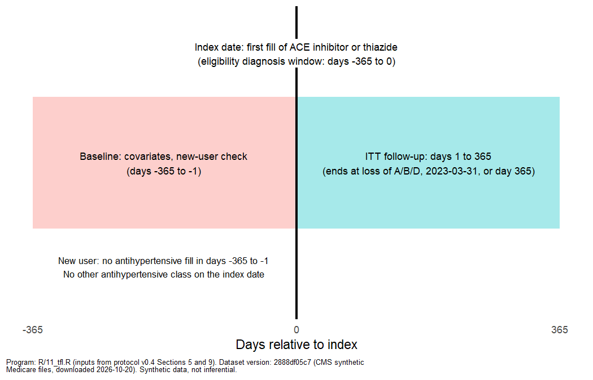
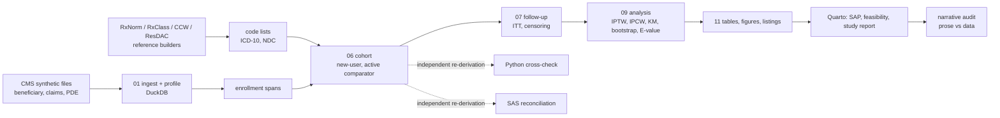

# medicare-claims-target-trial-rwe

[](https://github.com/erickyegon/medicare-claims-target-trial-rwe/actions/workflows/ci.yml)
    [](LICENSE)

Claims RWE methods demonstration: ACE inhibitor vs thiazide initiation on CMS synthetic Medicare data, designed as a target trial emulation.

> **Synthetic data. Nothing here is a real-world finding.** The estimates in this repository are programming and methods demonstrations. The CMS synthetic
> files come from a simulation (Synthea); CMS advises against scientific inference from them. Do not cite any result as evidence about a drug.

**For reviewers, in two minutes:** read [Results at a glance](#results-at-a-glance), then the [study report](docs/study_report.html) (rendered; source `docs/study_report.qmd`) and the [amendment log](docs/amendments.md), which records every analytic decision before it was used, including the two earlier research questions (influenza antivirals, bronchitis antibiotics) that the data could not support. Independent QC: [R vs Python cross-check](qc/python_crosscheck.py), [SAS reconciliation, all rows match](qc/sas_reconciliation.md), [prose-vs-data audit](qc/narrative_audit.py) (28 checks that recompute quoted numbers), and a [pre-commit scan](qc/id_leak_scan.py) that no record-level identifiers are tracked.

*About the name:* the project started as an influenza antiviral study, moved to bronchitis and antibiotics, and ended as the hypertension comparison below,
because the data could not support the first two questions. That path is documented in `docs/study_report.qmd` and `docs/amendments.md`.

## Results at a glance

*Illustrative only (synthetic data). The point is that the machinery works and is checked, not what the drug comparison shows.*

**Cohort** (adults 65+ with hypertension, new users, one episode per person): 9,179 beneficiaries, 790 in the final cohort (ACE inhibitor 433, thiazide/thiazide-like 357). Attrition (protocol v0.4 Section 5):

| Step | Persons | Episodes |
| --- | ---: | ---: |
| Beneficiaries in the files | 9,179 | |
| Study-drug fill on/after 2016-03-01 (candidate index dates) | 3,916 | 57,338 |
| New user (no antihypertensive fill in days -365 to -1) | 3,561 | 10,639 |
| Age 65 or older | 2,156 | 6,162 |
| Continuous Part A+B+D, 365-day look-back | 1,604 | 4,793 |
| Hypertension diagnosis (I10-I16) | 1,424 | 3,294 |
| Not both study drugs on the index date | 1,142 | 2,259 |
| No other antihypertensive class on the index date | 821 | 1,529 |
| No hospice claim | 792 | 1,466 |
| No inpatient stay overlapping the index date | 790 | 1,458 |
| First qualifying episode per person (final cohort) | **790** | 790 |

**Primary result** (IPTW, intention-to-treat, 365-day all-cause hospitalization, 500-resample bootstrap): risk 21.5% (ACE inhibitor) vs 17.7% (thiazide); risk difference 3.8 points (95% CI -3.5 to 9.4); risk ratio 1.21 (0.84 to 1.61). All 11 alternative analyses (an unweighted reference, untruncated weights, PS matching, IPCW, stricter diagnosis window, alternative follow-up rules and others) have intervals that include 1.0; see `output/tfl/T6.html`.



| Covariate balance (IPTW) | Weighted cumulative incidence |
| --- | --- |
|  |  |

## Pipeline



## Purpose

A portfolio project that shows, end to end, how an observational study on US Medicare claims is programmed: raw-file processing and checks, code lists, enrollment logic,
feasibility assessment, an active-comparator **new-user** cohort, propensity score weighting, censoring weights, weighted risk curves with bootstrap intervals,
sensitivity analyses, independent re-derivation of the cohort, and a full set of tables, figures and listings.

The final question: among adults 65+ with hypertension, does initiating an ACE inhibitor versus a thiazide or thiazide-like diuretic change 365-day all-cause hospitalization (intention-to-treat)?

## Data source and limitations

- **Source:** [CMS Synthetic Medicare Enrollment, Fee-for-Service Claims and Prescription Drug Event files](https://data.cms.gov/collection/synthetic-medicare-enrollment-fee-for-service-claims-and-prescription-drug-event) (free, no account). Pipe-delimited despite the `.csv` extension. File URLs are in `data/urls.txt`. Raw data are never committed (`data/` is git-ignored); outputs in `qc/` and `output/` are aggregate only.
- **Known facts about the files:** no deaths; no influenza claims; no ED revenue centers (ED visits cannot be seen); Part D covers about 70% of person-months; the generator gives the same background drug bundle to people with every condition.
- **Two named measures of Part D fills that cannot be linked to a drug.** PDE records only an NDC, so each fill is looked up in RxNorm (NLM RxNav, including retired NDCs):
  - **No RxNorm record** (measure 1): the NDC is not found in RxNorm at all. 101,407 of 515,520 fills (19.7%); 2,714 of 14,627 NDCs. Used for the new-user sensitivity cohort.
  - **No RxNorm drug concept** (measure 2): no RxNorm record, *or* a record that gives no drug (ingredient) concept. 107,298 fills (20.8%). It is the wider measure and contains measure 1. Exposure, the washout, drug counts and the indication scan use fills *with* a drug concept (its complement).
- **Consequences:** hospitalization means any inpatient admission; new-user status and exposure can be misclassified for the fills above; estimates are illustrative and wide.

## How to run

Requirements: R 4.4 or later, Quarto, Python 3.11 with `duckdb`, `pandas`, `pdfplumber`, `openpyxl`. R packages are pinned in `renv.lock`; run from the repository root.

```bash
Rscript -e "renv::restore()"                           # install the pinned R packages

# 0. data: download the 17 files listed in data/urls.txt into data/raw/ (unzip Carrier.zip into data/raw/carrier/ and Outpatient.zip into data/raw/outpatient/)

# 1. reference data (needs the network; outputs go to data/ref and codelists/)
python codelists/build/extract_ccw.py --all            # CCW code lists from the CCW algorithms PDF (save it to data/ref/ccw30_algorithms.pdf first)
python codelists/build/build_state_region.py           # ResDAC state-code table + Census regions (save both files to data/ref first)
python codelists/build/rxclass_antihypertensives.py    # study-drug and washout ingredient lists (RxClass)
python codelists/build/rxnorm_antibiotic_ndcs.py       # antibiotic NDCs for the retired bronchitis question (documented null)
python codelists/build/rxnorm_resolve_pde_ndcs.py      # RxNorm resolution of every PDE NDC (slow: rate-limited API)
python codelists/build/rxnorm_ingredient_atc.py        # ingredients and ATC classes for those NDCs

# 2. the pipeline, as a dependency graph (each target runs one program and tracks its outputs)
Rscript -e "targets::tar_make()"
#   or script by script: R/01_ingest.R, 04_enrollment.R, 03_codelists.R, 06_codelists_ahtn.R, 05_indication_scan.R, 06_cohort.R, 07_followup.R,
#   09_analysis.R, 10_manifest_facts.R, 11_tfl.R (and 02b_profile_extra.R, qc/python_crosscheck.py, qc/narrative_audit.py)

# 3. checks and documents
Rscript tests/testthat.R                               # unit tests + end-to-end test on a simulated fixture (no CMS data needed)
python qc/python_crosscheck.py                         # independent pandas re-derivation of attrition, arms, ITT end dates, 365-day events
python qc/narrative_audit.py                           # recomputes every number quoted in the static prose and checks the text
quarto render docs/feasibility.qmd; quarto render docs/sap.qmd; quarto render docs/study_report.qmd
```

**SAS reconciliation is run manually in SAS OnDemand.** `sas/cohort_qc.sas` re-derives the attrition table and baseline counts independently of the R code and reconciles them against `qc/cohort/attrition.csv`
and `qc/cohort/cohort_baseline_counts.csv` (setup instructions are in the program header; `sas/import_raw.sas` is generated by `sas/build/gen_sas_import.py`). First run 2026-10-21: all 11 attrition rows and 10 baseline rows match R (`qc/sas_reconciliation.md`). CI does not run it.

Continuous integration (`.github/workflows/ci.yml`) runs the tests and renders the documents from the committed aggregate outputs on every push. Several pipeline steps add tables to the same DuckDB file, so only a clean `tar_make()` (no `_targets/` cache) is a faithful full rebuild.

## Repository map

```
docs/        protocol.md (v0.4), amendments.md, sap.qmd, feasibility.qmd, study_report.qmd, archive/ (earlier protocols)
codelists/   ICD-10 (bronchitis, exclusions, hypertension), ingredient and NDC lists, CCW lists, state-region list; each with source and date; build/ = scripts that build them
R/           numbered pipeline (01_ingest ... 11_tfl); *_functions.R and format_tables.R = shared functions covered by tests
sql/         enrollment_spans, canonical, index_events, followup, baseline (DuckDB), scan_* (indication scan)
sas/         cohort_qc.sas (independent re-derivation), download_raw.sas, inputs_codelists.sas, import_raw.sas (generated), build/
tests/       testthat: enrollment, cohort, follow-up, baseline, analysis functions, end-to-end fixture
qc/          profiling report, step log, typing check, cohort/ analysis/ scan/ outputs (aggregate only), python_crosscheck.py, narrative_audit.py
output/tfl/  tables (T1-T7), figures (F1-F4), listings (L1-L2), provenance.csv
_targets.R   pipeline graph        DESCRIPTION, renv.lock   dependencies        LICENSE   MIT
```

## What each part demonstrates

| Component | RWE programmer skill |
| --- | --- |
| `R/01_ingest.R`, `R/02_profile.R`, `qc/profiling.qmd`, typing check | Claims processing: raw-file ingestion, type conversion without silent loss, profiling (duplicates, impossible dates, missingness, constant fields) |
| `sql/enrollment_spans.sql`, `R/04_enrollment.R` | Enrollment logic: monthly entitlement, continuous spans, look-back windows |
| `codelists/`, `R/03_*.R`, `R/06_codelists_ahtn.R`, `codelists/build/` | Code lists from official sources (ICD-10-CM, CCW, FDA NDC, RxNorm/RxClass, ResDAC, Census), versioned with source and date |
| `R/05_indication_scan.R`, `sql/scan_*.sql`, `docs/feasibility.qmd` | Feasibility: systematic scan for an estimable question, attrition, arm sizes, event counts, documented nulls |
| `sql/index_events.sql`, `R/06_cohort.R` | Cohort building: new-user design, sequential criteria, one episode per person, sensitivity cohorts |
| `R/07_followup.R`, `sql/followup.sql` | Follow-up, censoring rules, outcome windows, add-on/switch/discontinuation from days supply |
| `R/08_baseline.R`, `R/09_analysis_functions.R`, `R/09_analysis.R` | Propensity score methods: IPTW, balance diagnostics, matching, IPCW; confounding control |
| weighted KM and pooled logistic, bootstrap, E-value | Survival and longitudinal methods; uncertainty by resampling individuals |
| `R/11_tfl.R`, `R/format_tables.R`, `output/tfl/` | Tables, figures and listings with provenance footnotes |
| `docs/protocol.md`, `amendments.md`, `sap.qmd`, `study_report.qmd` | Protocols, amendments, SAP and study report |
| `tests/`, `qc/python_crosscheck.py`, `qc/narrative_audit.py`, `sas/cohort_qc.sas` | QC: unit tests with hand-built beneficiaries, independent re-derivation in Python and SAS, prose checked against data |
| R, SQL (DuckDB), SAS, Python, Quarto, GitHub Actions, targets, renv | Tooling |

## Honest notes

- Selection of the hypertension question used arm sizes and crude aggregate counts only (no effect estimates), and three candidate-selection passes are kept in the scan report as run, including the ones that produced artifacts.
- Some modelling choices were made by the author where the protocol was silent (amendment A-011); all amendments are logged before use, with a status legend at the top of `docs/amendments.md`.
- All reported intervals are wide and the data are synthetic. The results say how the machinery works, not what ACE inhibitors or thiazides do.

## Licence

MIT, see `LICENSE`. The CMS synthetic data are public and are not redistributed here.
