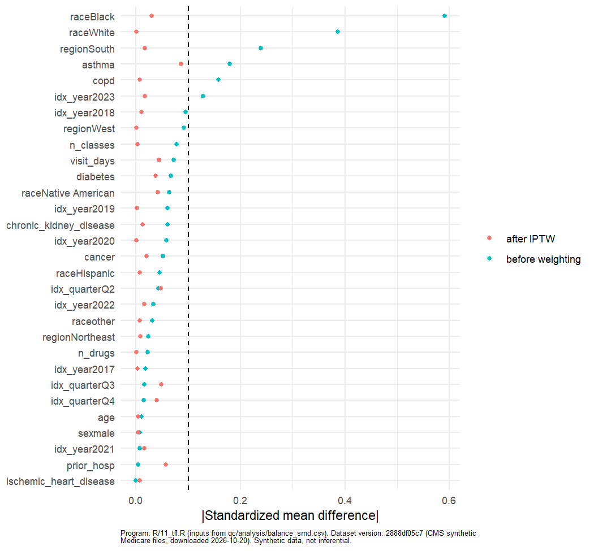
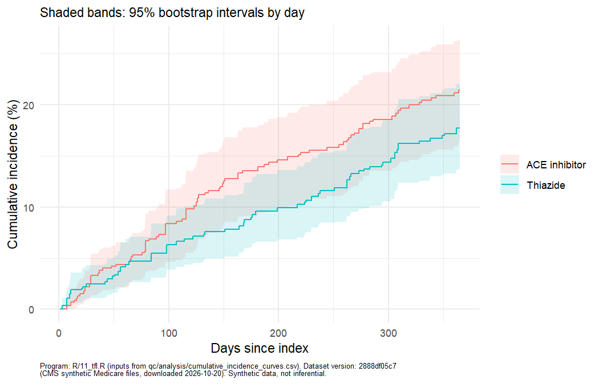

```{r setup}
source("_helpers.R")   # Quarto renders with docs/ as the working directory
fx <- S("qc", "feasibility_facts.csv"); att <- S("qc", "cohort", "attrition.csv"); arms <- S("qc", "cohort", "arm_sizes.csv")
pr <- S("qc", "analysis", "primary_results.csv"); se <- S("qc", "analysis", "sensitivity_results.csv"); ev <- S("qc", "analysis", "evalue.csv")
bal <- S("qc", "analysis", "balance_smd.csv"); pc <- S("qc", "analysis", "primary_counts.csv"); ps <- S("qc", "analysis", "ps_and_weights_summary.csv")
ce <- S("qc", "cohort", "crude_events.csv"); nc <- S("qc", "analysis", "negative_control_descriptive.csv"); rp <- S("qc", "cohort", "refill_pattern.csv")
tc <- S("qc", "cohort", "timing_counts.csv"); ipd <- S("qc", "analysis", "ipcw_loss_diagnostics.csv")
g <- function(pat) fx$value[grepl(pat, fx$item, fixed = TRUE)][1]
gs <- function(pat) fx$share_pct[grepl(pat, fx$item, fixed = TRUE)][1]
p <- function(m, h, q, col = "estimate") pr[[col]][pr$method == m & pr$horizon == h & pr$quantity == q]
km <- "weighted KM"
```

## What this is, and what it is not

This is a **programming and methods demonstration** on the CMS synthetic Medicare files (generated by Synthea). It shows claims processing, cohort building, feasibility assessment,
a new-user active-comparator design, propensity score weighting, censoring weights, bootstrap intervals and reporting. The synthetic data come from disease modules, not from patients,
so **no estimate in this report is a treatment effect or a real-world finding**, and CMS advises against scientific inference from these files. Dataset version `r dataset_version()`.

## 1. How the question changed: the feasibility narrative

The study began as a different question and changed twice because the data could not support it. Each step below is recorded in `docs/amendments.md` and the protocol history; numbers are read from the pipeline outputs.

| Stage | Question | What the data showed | Decision and record |
| --- | --- | --- | --- |
| Protocol v0.1 (`docs/archive/protocol_v0.1_original.md`) | Oseltamivir within 2 days vs no antiviral after outpatient influenza, 30-day hospitalization and death | `r fmt(g("influenza diagnoses"))` influenza diagnoses (J09-J11), `r fmt(g("oseltamivir"))` oseltamivir drug concepts among the RxNorm-resolved PDE NDCs, `r fmt(g("deaths recorded"))` deaths in the beneficiary files (`qc/feasibility_findings.md`) | Influenza question not estimable; reported as a null. Re-scoped to a respiratory condition the data do model (protocol v0.2) |
| Protocol v0.2 (`docs/archive/protocol_v0.2_bronchitis.md`) | Oral antibiotic within 2 days vs none after outpatient acute bronchitis, 30-day hospitalization or ED visit | ED visits are not observable (no ED revenue centers: `r fmt(g("ED revenue"))` rows; no ED procedure or place-of-service codes), so the primary outcome became all-cause hospitalization (**A-001**); the index-setting covariate was dropped (**A-002**); chronic conditions were defined by one claim in the baseline year (**A-003**) | With an `r fmt(nrow(S("codelists", "ndc_antibiotics.csv")))`-NDC antibiotic list (FDA directory plus RxNorm history), no antibacterial (ATC J01) class was filled around a first bronchitis claim (`r sum(grepl("^J01", S("qc", "scan", "bronchitis_recheck_classes.csv")$atc_id))` such classes); the most common classes were `r paste(head(S("qc", "scan", "bronchitis_recheck_classes.csv")$atc_id, 3), collapse = ", ")` (analgesic, cough and antihistamine products). **A-004:** not estimable, Phase 3 not run for this question |
| Indication scan | Which indication and exposure does the generator model well enough to emulate a trial? | `r nrow(S("qc", "scan", "acute_scan.csv"))` acute diagnosis codes were screened, and `r n_distinct(S("qc", "scan", "chronic_condition_classes.csv")$atc_id)` drug classes had at least 200 new users for some chronic condition (aggregate output only; `qc/indication_scan.html`). Rule-based passes surfaced artifacts (generic social-problem codes with background drugs; one insulin product counted under several ATC classes); the hypertension candidates came from the hand-curated pass | Three passes are kept and labelled in the scan report (pre-specified, refined, curated). Selection used arm sizes and crude aggregate counts only, no effect estimates |
| Protocol v0.3 to v0.4 (`docs/protocol.md`) | ACE inhibitor vs thiazide or thiazide-like diuretic initiation, 365-day all-cause hospitalization, intention-to-treat | `r fmt(arms$n[arms$arm == "ACEI"])` and `r fmt(arms$n[arms$arm == "THIAZIDE"])` people after all criteria | **A-005** (re-scope). Refinements: **A-006** (negative-control codes lack a 7th character), **A-007** (as-treated analysis dropped: second fills come a median `r rp$median_days_to_second_fill` days after a `r rp$index_days_supply_median`-day first fill), **A-008** (ITT follow-up rule), **A-009** (diagnosis window days -365 to 0), **A-010** (co-start exclusion and two sensitivity analyses), **A-011** (modelling specifications), **A-012** (state-to-region code list from official sources, replacing a mapping typed from memory), **A-013** (IPCW for loss of entitlement) |

The first move (influenza to bronchitis) was made at the end of the profiling phase and is recorded in the protocol version history and `qc/feasibility_findings.md`; amendments are numbered from A-001, raised in the bronchitis phase.

## 2. Data, design and methods in brief

- **Data:** CMS Synthetic Medicare Enrollment, FFS Claims and PDE files, March 2015 to March 2023 (last claim date 2023-03-02); `r fmt(g("beneficiaries (distinct"))` beneficiaries. Part D covers `r sprintf("%.1f", gs("Part D share"))`% of person-months; `r sprintf("%.1f", gs("no RxNorm record"))`% of fills have no RxNorm record (measure 1) and `r sprintf("%.1f", gs("no RxNorm drug concept"))`% have no RxNorm drug concept (measure 2; both defined in the README).
- **Design:** new users aged 65 or older with continuous Part A, B and D entitlement for 365 days, a hypertension diagnosis (I10-I16), no antihypertensive fill in the previous 365 days, and a first fill of an ACE inhibitor or a thiazide or thiazide-like diuretic. Time zero is the first fill. Details in the protocol and SAP.
- **Analysis:** propensity score, stabilized IPTW (truncated at the 1st and 99th percentile), weighted Kaplan-Meier and weighted pooled logistic regression, 500-resample bootstrap intervals; sensitivity analyses listed in the SAP.

## 3. Results (illustrative)

### Cohort

```{r t1}
kt(att %>% transmute(Step = step, Criterion = description, Episodes = n_episodes, Persons = n_persons, `Persons removed` = persons_removed))
```

The final cohort has `r fmt(att$n_persons[att$step == 10])` people: `r paste(arm_lab(arms$arm), fmt(arms$n), collapse = " and ")`. The hypertension-diagnosis requirement removed `r fmt(att$persons_removed[att$step == 5])` people.
The attrition table was re-derived independently in pandas (identical at every step) and in SAS (run in SAS OnDemand on 2026-10-21: all 11 attrition rows and all 10 baseline-count rows match the R output; see `qc/sas_reconciliation.md`).

### Balance

Before weighting the largest absolute standardized mean difference was `r sprintf("%.2f", max(abs(bal$smd_unweighted)))`; after IPTW it was `r sprintf("%.2f", max(abs(bal$smd_weighted)))`
(target below 0.10; `r sum(abs(bal$smd_weighted) >= 0.1)` of `r nrow(bal)` covariate columns at or above 0.10). The propensity score c-statistic was `r sprintf("%.2f", ps$ps_c_statistic[1])`;
effective sample sizes after weighting were `r paste(arm_lab(ps$arm), sprintf("%.0f", ps$effective_n), collapse = " and ")`, and `r sum(ps$n_truncated)` weights were truncated.

```{r f2, out.width = "70%"}

```

### Primary and secondary outcomes

Crude hospitalization events within 365 days: `r paste(arm_lab(pc$arm), pc$hosp_365_events_unweighted, collapse = " and ")` (`r paste(arm_lab(pc$arm), pc$n, sep = ": ", collapse = "; ")` people).

```{r t5}
w <- pr %>% pivot_wider(names_from = quantity, values_from = c(estimate, lo, hi)) %>% arrange(desc(method), desc(horizon))
kt(w %>% transmute(Method = method, Horizon = paste(horizon, "days"), `ACE inhibitor risk %` = ci(estimate_risk_acei, lo_risk_acei, hi_risk_acei), `Thiazide risk %` = ci(estimate_risk_thiazide, lo_risk_thiazide, hi_risk_thiazide),
                   `Risk difference, points` = ci(estimate_rd, lo_rd, hi_rd), `Risk ratio` = ci(estimate_rr, lo_rr, hi_rr, 1, 2)))
```

In the weighted Kaplan-Meier analysis the 365-day risk was `r sprintf("%.1f", 100 * p(km, 365, "risk_acei"))`% for the ACE inhibitor arm and `r sprintf("%.1f", 100 * p(km, 365, "risk_thiazide"))`% for the thiazide arm:
a risk difference of `r ci(p(km, 365, "rd"), p(km, 365, "rd", "lo"), p(km, 365, "rd", "hi"))` percentage points and a risk ratio of `r ci(p(km, 365, "rr"), p(km, 365, "rr", "lo"), p(km, 365, "rr", "hi"), 1, 2)`.
`r if (all_include(p(km, 365, "rd", "lo"), p(km, 365, "rd", "hi"), 0)) "The interval for the risk difference includes zero." else "The interval for the risk difference excludes zero."`
The weighted pooled logistic model gave a 365-day risk ratio of `r sprintf("%.2f", p("weighted pooled logistic", 365, "rr"))`. The E-value for the point estimate is `r sprintf("%.2f", ev$value[1])` and `r sprintf("%.2f", ev$value[2])` for the confidence limit.
For the secondary 30-day outcome the weighted pooled logistic model was fitted to days 1-30 only (A-014), because a 4-df spline over 365 days cannot resolve the first-month hazard; it gave a risk ratio of `r sprintf("%.2f", p("weighted pooled logistic", 30, "rr"))`, against `r sprintf("%.2f", p("weighted pooled logistic, 365-day model read at day 30", 30, "rr"))` when the 365-day model is read at day 30 (both are in T5). The risk difference was `r ci(p(km, 30, "rd"), p(km, 30, "rd", "lo"), p(km, 30, "rd", "hi"))` percentage points (weighted Kaplan-Meier); the 30-day analysis rests on few events (`r paste(arm_lab(ce$arm), ce$hosp_30, collapse = " and ")`), so it is unstable.

```{r f4, out.width = "80%"}

```

### Sensitivity analyses

```{r t6}
kt(se %>% transmute(Analysis = trunc_chr(analysis, 80), N = n, `ACE inhibitor risk %` = sprintf("%.1f", 100 * km365_risk_acei), `Thiazide risk %` = sprintf("%.1f", 100 * km365_risk_thiazide),
                    `RD, points` = ci(km365_rd, km365_rd_lo, km365_rd_hi), `RR` = ci(km365_rr, km365_rr_lo, km365_rr_hi, 1, 2)))
sens_only <- se[-1, ]
```

Across the `r nrow(sens_only)` sensitivity analyses, `r if (all_include(sens_only$km365_rr_lo, sens_only$km365_rr_hi)) "every 95% interval for the risk ratio includes 1.0" else paste0(n_excluding(sens_only$km365_rr_lo, sens_only$km365_rr_hi), " intervals exclude 1.0")`;
the point estimate of the risk ratio was above 1 in `r sum(sens_only$km365_rr > 1)` and below 1 in `r sum(sens_only$km365_rr < 1)` of them (primary analysis: `r sprintf("%.2f", se$km365_rr[1])`;
range across sensitivity analyses `r sprintf("%.2f", min(sens_only$km365_rr))` to `r sprintf("%.2f", max(sens_only$km365_rr))`). `r far <- which.max(abs(log(sens_only$km365_rr) - log(se$km365_rr[1]))); sprintf("The analysis furthest from the primary risk ratio on the log scale is \"%s\" (%d people, risk ratio %.2f).", sens_only$analysis[far], sens_only$n[far], sens_only$km365_rr[far])`
The IPCW analysis for loss of Part A/B/D entitlement used `r ipd$value[1]` censoring events (IPCW multipliers `r ipd$value[2]` to `r ipd$value[4]`).

### Negative control, treatment patterns and refills

```{r t7}
kt(nc %>% transmute(Arm = arm_lab(arm), N = n, `Fracture events` = fracture_365_itt, `Person-years` = py_fracture))
```

The negative control (hip or femur fracture) is reported descriptively only: `r paste(arm_lab(nc$arm), nc$fracture_365_itt, collapse = " and ")` events, too few to interpret (counts below 11 are not interpretable).

```{r t4}
kt(tc %>% transmute(Arm = arm_lab(arm), N = n, `Add-on` = n_addon, Switch = n_switch, Discontinued = n_discontinued, `Index days supply (median)` = idx_days_supply_median))
```

Add-on or switch to the other study drug was rare (`r paste(arm_lab(tc$arm), tc$n_addon + tc$n_switch, collapse = " and ")` people). Most people have a single 90-day fill followed by a second fill about a year later
(`r fmt(rp$with_second_fill)` of `r fmt(rp$cohort_n)` have a second fill, median `r rp$median_days_to_second_fill` days), which is why discontinuation does not censor any analysis.

## 4. Limitations and what not to conclude

- The data are synthetic: relationships between drugs, conditions and hospitalizations come from the generator, not from biology. Do not read any estimate as evidence about ACE inhibitors or thiazides.
- `r sprintf("%.1f", gs("no RxNorm drug concept"))`% of fills have no RxNorm drug concept (measure 2) and `r sprintf("%.1f", gs("no RxNorm record"))`% have no RxNorm record (measure 1), so new-user status and exposure can be misclassified; a sensitivity analysis removes people with a baseline fill that has no RxNorm record.
- ED visits are not observable; hospitalization means any inpatient admission.
- The same background drug bundle (including ACE inhibitors and thiazides) appears across all conditions in the generator, so indication-specific confounding is unlike real practice.
- Follow-up ends when Part D entitlement is lost (Part D coverage is patchy); two sensitivity analyses address this.
- Event counts are modest, intervals are wide, and the 30-day analysis is unstable.

## 5. Reproducibility

Programs in `R/`, SQL in `sql/`, code lists in `codelists/`, tests in `tests/`, continuous integration in `.github/workflows/ci.yml`. SAS reconciliation (`sas/cohort_qc.sas`) was run in SAS OnDemand on 2026-10-21 with all attrition and baseline rows matching R (`qc/sas_reconciliation.md`); it is not part of CI.
Every table, figure and listing in `output/tfl/` names its generating program and the dataset version.
